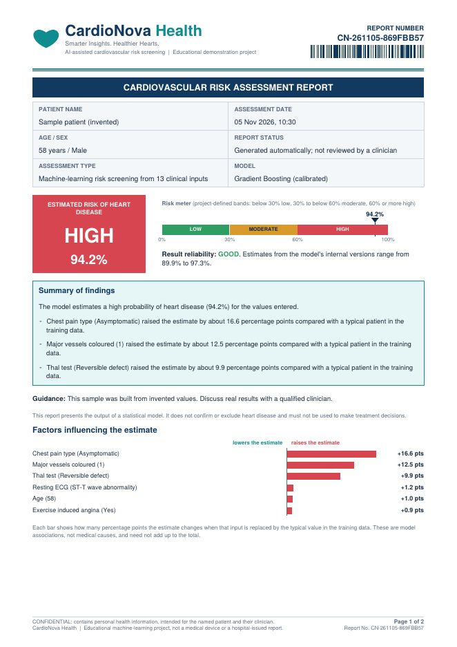
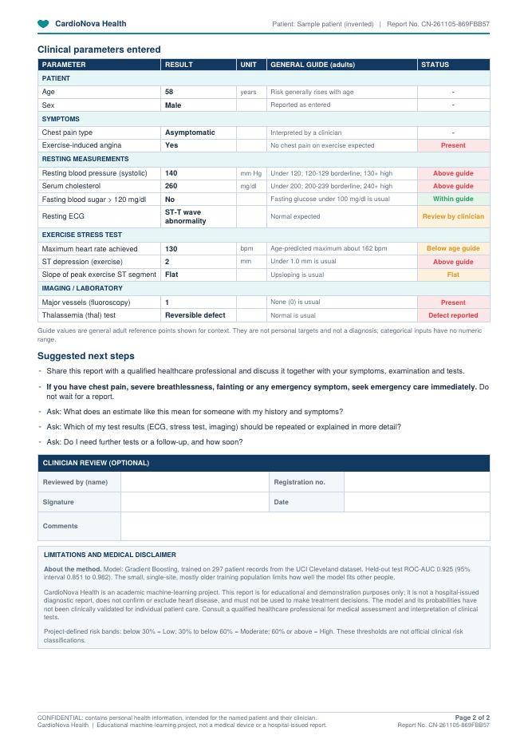

<div align="center">

# 🫀 CardioNova Health

### Uncertainty-aware heart disease risk estimation: a Django + scikit-learn web application

<p>
  
  
  
  
</p>

</div>

> **Medical disclaimer.** CardioNova Health is an educational and portfolio project. It is not a medical device, does not diagnose, treat or prevent any disease, and must not be used for medical decisions. See [Limitations](#-limitations).

## 💡 What makes it different

Most heart-disease projects print one probability. CardioNova also tells you **how far that number can be trusted**, **why the model produced it**, and **what to ask a doctor**:

| Feature | What it does |
|---|---|
| **Trust check** | Per prediction, combines (1) inputs outside the 1st–99th percentile of the training data, (2) disagreement between the cross-validation fold models, (3) closeness to a risk-band limit, and (4) data-entry checks (for example a resting pulse typed as the exercise maximum). Result: Good / Fair / Low, with reasons and a probability range. |
| **Plain-language summary** | Turns the model output into short sentences and "questions you could ask a doctor". Generated **on the server by fixed rules** from the model's own outputs; nothing is sent to an outside service, so no health data leaves the application. |
| **What-if simulator** | Sliders for blood pressure, cholesterol and blood sugar re-score the stored record server-side. Shown as model behaviour, not as medical cause and effect. |
| **Factor explanation** | Median-replacement ablation: each input is swapped for the training median and the change in probability is shown in percentage points. |
| **Validated trust check** | Checked by nested cross-validation on all records: predictions marked Good were wrong 3.0% of the time, Fair 16.9%, Low 38.1% (see below). |
| **Two-factor login** | Authenticator-app codes (standard TOTP, RFC 6238, implemented with the standard library and checked against the RFC's test vectors), one-time recovery codes, replay protection, lockout, optional "doctors must use it" switch. |
| **Drift monitor** | Compares recent inputs with the training data (population stability index per input, small-sample noise removed); command line, staff page, and log warnings for out-of-range inputs. |
| **Experiment tracking** | Every training run is logged with a data fingerprint (`model/experiments.jsonl`, shown on the model page); optional MLflow. |
| **Privacy-first sharing** | Doctor access is **opt-in** (off by default); every doctor view is written to an access log that the patient can read. |

## ✨ Features

- Web app: registration and login, prediction form, result page with gauge, history with charts, batch CSV upload, a clinical-style PDF report (below), dark mode, FAQ, contact form, print stylesheet.
- Roles: patient and doctor; doctors see only patients who opted in.
- JSON API with hashed bearer tokens (`/api/predict/`, `/api/whatif/`, `/api/history/`).
- Security hardening: two-factor login, per-IP and per-user rate limits (Redis-ready, with a fail-open or fail-closed choice if the store is down), CSP without inline code, security headers, upload and request-size limits, CSV-formula protection, OTP and e-mail-link password reset, delete-account with password. Details: [docs/SECURITY.md](docs/SECURITY.md).
- No third-party requests: charts are drawn with the browser's canvas, so the CSP allows scripts from this site only.
- Operations: `drift_report` command (works in cron or CI), staff drift page, experiment log, Redis service in `docker-compose.yml`. See [docs/OPERATIONS.md](docs/OPERATIONS.md).
- Demo data: `python manage.py seed_demo` creates a demo patient (six sample records) and a demo doctor so every page and button can be tried.
- Delivery: Dockerfile (non-root), docker-compose with PostgreSQL, Render blueprint, GitHub Actions CI.

## 📄 Clinical-style PDF report

The download is a two-page A4 report laid out like a hospital report: letterhead with a barcode of the report number, patient and assessment details, the risk category with a **risk meter**, a **result-reliability** box (with a red warning when the trust check is Low), a summary of findings, **clinical parameters with general guide ranges and a status for each value**, a factor chart, suggested next steps (including an emergency-symptoms line), an optional **clinician-review block** (name, registration no., signature, date, comments), method notes, a disclaimer, and a footer with "Page x of y" on every page.

| Page 1 | Page 2 |
|---|---|
|  |  |

It stays honest about what it is: the footer and disclaimer say it is an educational machine-learning report, the status line says it was generated automatically and not reviewed by a clinician, and no hospital, licence or signature is invented. The report number is a keyed hash, so it does not reveal the database id. Sample PDFs (invented data) are in `docs/sample_reports/`.

## 🧠 Machine-learning pipeline

1. Load `dataset/heart.csv` (UCI Cleveland, original coding), drop duplicates and rows with missing values: **297 records**; target converted to disease / no disease.
2. Stratified 80/20 split (237 train / 60 test) **before** any fitting; imputer and scaler live inside the pipeline (no leakage).
3. Tune six models with `GridSearchCV` (5-fold stratified, ROC-AUC) and build a voting and a stacking ensemble.
4. **Select the model on cross-validation ROC-AUC of the training data only**; the test set is touched once.
5. Calibrate probabilities (sigmoid, 5-fold). The fold models also feed the trust check.
6. Evaluate on the untouched test set with bootstrap confidence intervals; permutation importance; charts saved for the web app.

### Results (`model/model_info.json`, trained 2026-10-27 11:21, scikit-learn 1.8.0)

Selected model: **Gradient Boosting**, cross-validated Brier score 0.1392 (raw) vs 0.1411 (calibrated). Calibration is always applied because the difference is negligible and the trust check needs the fold models.

| Model | CV ROC-AUC | Test accuracy | Test recall | Test ROC-AUC |
|---|---:|---:|---:|---:|
| Gradient Boosting **(selected)** | 0.894 | 0.817 | 0.75 | 0.924 |
| Random Forest | 0.891 | 0.833 | 0.75 | 0.941 |
| Stacking Ensemble | 0.888 | 0.85 | 0.75 | 0.948 |
| Voting Ensemble | 0.885 | 0.867 | 0.786 | 0.952 |
| Support Vector Machine | 0.884 | 0.883 | 0.893 | 0.953 |
| Logistic Regression | 0.88 | 0.867 | 0.786 | 0.951 |
| K-Nearest Neighbors | 0.872 | 0.85 | 0.786 | 0.96 |
| Decision Tree | 0.838 | 0.8 | 0.714 | 0.889 |

**Final model on the test set at the usual 50% cut-off:** accuracy 0.817 (95% CI 0.717–0.917), precision 0.87, recall 0.714 (95% CI 0.536–0.885), ROC-AUC 0.925 (95% CI 0.851–0.982), Brier 0.121.

**At the app's own LOW/MODERATE limit (0.3),** which is fixed in advance and not tuned on the test set, anything at or above it counts as "not low": recall **0.929** (26 of 28 positives found), precision 0.765, 2 missed.

### Does the trust check work?

Nested 10-fold cross-validation on all 297 records (every record is scored by a model that never saw it; the trust level uses the web app's own rules, `ml.signal_points`):

| Trust level | Predictions | Wrong at 50% cut-off | Error rate (95% interval) |
|---|---:|---:|---:|
| Good | 66 | 2 | 3.0% (0.8–10.4%) |
| Fair | 189 | 32 | 16.9% (12.3–22.9%) |
| Low | 42 | 16 | 38.1% (25.0–53.2%) |

Answering only when trust is Good or Fair would cover 85.9% of cases at 86.7% accuracy (all cases: 83.2%). The trust score separates right from wrong predictions with ROC-AUC 0.701: useful, not perfect. The Good and Low intervals do not overlap, but the groups are small.

How to read this honestly:

- The test set has only 60 records, so every number has a wide interval. Models that rank differently on the test set (for example SVM or k-NN) are **within noise** of the selected model; the choice was made on training cross-validation, not by looking at the test set.
- A high ROC-AUC does not establish clinical usefulness. These are experimental results on one small, single-site dataset.
- **Dataset hygiene:** the popular Kaggle copies of this data are the same Cleveland patients (one has 723 duplicate rows, one flips the label), so they cannot serve as a second dataset. Guards refuse them and remove overlapping rows; see [docs/DATASETS.md](docs/DATASETS.md).
- External validation is supported but not yet run: `python scripts/fetch_uci_external.py` downloads the Hungarian, Switzerland and VA files, and `python train_model.py` then reports metrics on them.

## 🚀 Getting started

**Local (Windows PowerShell shown; the same commands work elsewhere):**

```powershell
git clone https://github.com/manishyadav-aiml/CardioNova-Health.git
cd CardioNova-Health
python -m venv venv
.\venv\Scripts\Activate.ps1
pip install -r requirements.txt
python manage.py migrate
python manage.py runserver
```

Open http://127.0.0.1:8000/. The committed model files match the pinned `scikit-learn`; to retrain run `python train_model.py` (add `--quick` for a fast, smaller search).

Settings run with **DEBUG off by default**. `manage.py` switches development mode on only when it finds no `.env`, no `DJANGO_SECRET_KEY`, no `DJANGO_DEBUG` and no `DATABASE_URL` (a plain local checkout). Everything else (gunicorn, Docker, Render) must set `DJANGO_SECRET_KEY`; for a local `.env` add `DJANGO_DEBUG=1`. See [.env.example](.env.example).

**Docker (web + PostgreSQL):** copy `.env.example` to `.env`, fill in real values, then `docker compose up --build`.
**Render:** New → Blueprint → select the repository (`render.yaml`). More in [docs/DEPLOYMENT.md](docs/DEPLOYMENT.md).

**Try everything with demo data:** `python manage.py seed_demo` prints one-time passwords for `demo_patient` and `demo_doctor`.
**Make a doctor account:** `python manage.py make_doctor <username>`.

## 🧪 Tests and CI

```powershell
python manage.py test
```

160 Python test methods and 18 JavaScript tests cover forms, the prediction flow, access control, the trust check and what-if simulator, the data-entry checks and summary, opt-in sharing, rate limits (including behind a proxy), upload rules, XSS/CSV-injection escaping and security headers. `python scripts/audit_ui.py` statically checks that every button, link, form and script hook is wired up, and `node tests_js/*.test.js` tests the charts, the confirm dialogs, the dark-mode switch and the what-if simulator. GitHub Actions runs the UI audit, the JavaScript tests, a quick training, the migration check, the tests, `manage.py check --deploy`, a repository security scan and a gitleaks history scan.

## 🗂️ Project structure

```text
CardioNova-Health/
├── heart_disease/        Django settings, urls
├── prediction/           app: views, forms, ml.py (inference, trust check, summary), totp.py (2FA), drift.py, security.py, report.py (PDF), templates, static, tests
├── train_model.py        tuning, comparison, calibration, evaluation, charts, model_info.json
├── model/                saved model, preprocessing, metrics
├── dataset/              heart.csv (Cleveland) and dataset/external/ for external validation
├── scripts/              security_check.py, audit_ui.py, fetch_uci_external.py, convert_kaggle_heart.py
├── ml_pipeline/          dataset loading, experiment tracking (tracking.py)
├── tests_js/             Node tests for charts.js, main.js, whatif.js
├── docs/                 SECURITY, DEPLOYMENT, OPERATIONS, DATASETS, checklist, interview guide, CHANGELOG, sample_reports/ (PDFs)
└── Dockerfile, docker-compose.yml, render.yaml, .github/workflows/ci.yml
```

## ⚠️ Limitations

- 297 complete records from one historical, single-site dataset (mostly older patients); not representative of all populations.
- Not clinically validated; probabilities are model estimates, not personal risk measurements. Risk bands (30% / 60%) are project-defined.
- Explanations are associations learned from data, not causes.
- No external validation results yet (see above).
- Rate-limit counters are per worker unless `REDIS_URL` is set (the Docker setup sets it).
- Two-factor: the authenticator secret is stored unencrypted in the database (protect the database itself); the Django admin login and the API token are not covered by it.

## 🔭 Roadmap

Run the external validation (script ready) · fairness analysis by sex and age · QR code in the two-factor setup · e-mail verification · encrypted storage of the authenticator secret · passkeys (WebAuthn) · alerting from the drift command.

## 👨‍💻 Author

**Manish Kumar Yadav**, final-year B.Tech CSE (AI/ML), Sandip University, Nashik.
GitHub: https://github.com/manishyadav-aiml · Repository: https://github.com/manishyadav-aiml/CardioNova-Health

## 📜 License

MIT, see [LICENSE](LICENSE). Educational project, not a medical device.
